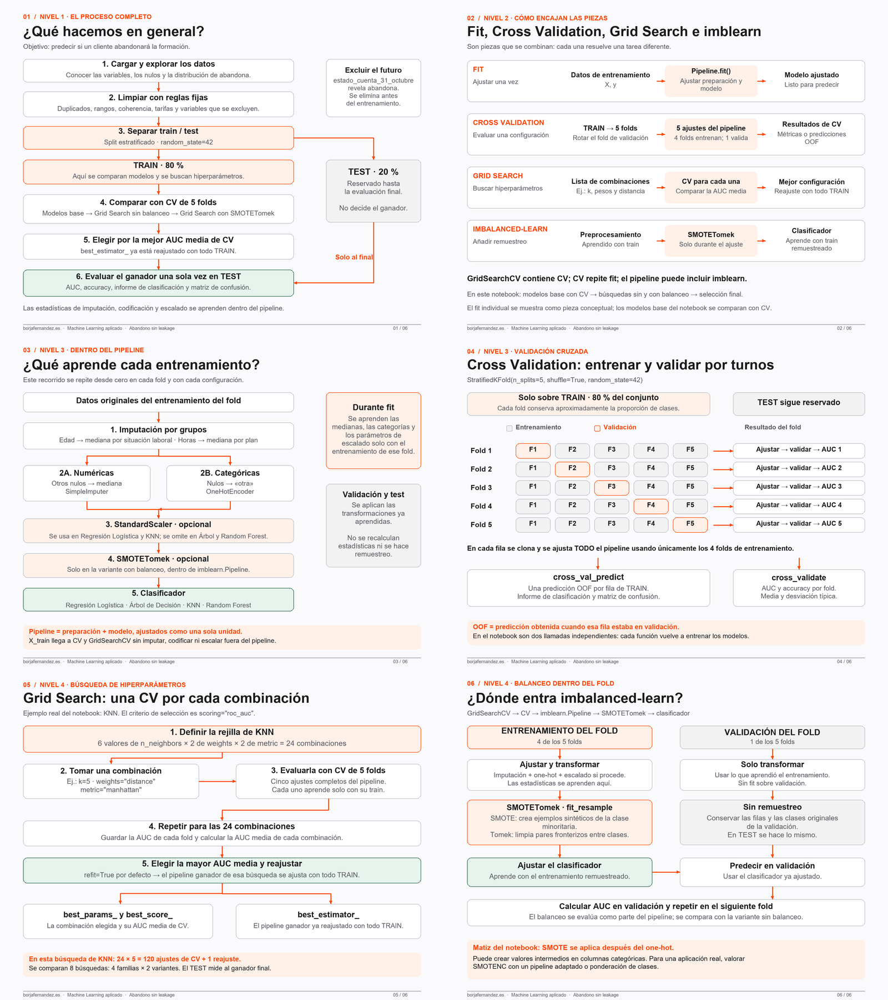

# Diagramas de flujo · Abandono sin leakage

Seis imágenes de 1920 × 1440 píxeles, ordenadas desde la vista general al detalle. Los SVG permiten ampliarlas sin perder nitidez. El archivo Excalidraw reúne los seis diagramas en un lienzo editable.

| Nivel | Diagrama | PNG | SVG | Celdas del notebook (índice desde cero) |
|---|---|---|---|---|
| 1 | Vista general del proceso | [Imagen](01_vista_general.png) | [Vector](01_vista_general.svg) | 0–110, 113–122 |
| 2 | Cómo encajan fit, CV, Grid Search e imblearn | [Imagen](02_como_encajan.png) | [Vector](02_como_encajan.svg) | 111–121 |
| 3 | Pipeline sin fugas de información | [Imagen](03_pipeline_sin_fugas.png) | [Vector](03_pipeline_sin_fugas.svg) | 109–111 |
| 4 | Validación cruzada de 5 folds | [Imagen](04_validacion_cruzada.png) | [Vector](04_validacion_cruzada.svg) | 111, 113–114 |
| 5 | Grid Search paso a paso | [Imagen](05_grid_search.png) | [Vector](05_grid_search.svg) | 115–116, 119–121 |
| 6 | Imbalanced-learn y SMOTETomek | [Imagen](06_imblearn_y_balanceo.png) | [Vector](06_imblearn_y_balanceo.svg) | 111, 117–121 |

[Abrir el lienzo editable](diagramas_abandono_completo.excalidraw). Para editarlo, importa ese archivo en [Excalidraw](https://excalidraw.com).

## Criterios de lectura

- Se describe el código del notebook proporcionado. No se ha ejecutado el entrenamiento ni se atribuyen resultados numéricos a los modelos.
- Fit individual se muestra como concepto. La comparación de modelos base del notebook usa validación cruzada, primero con cross_val_predict y después con cross_validate.
- Un fold es una de las cinco particiones de TRAIN. Cuatro entrenan y una valida; el test externo no es un fold.
- La estratificación mantiene aproximadamente la proporción de clases. No balancea las clases.
- GridSearchCV repite el pipeline completo en cada combinación y fold. Cada una de las ocho búsquedas reajusta su propio ganador sobre todo TRAIN; después se compara su best_score_ y se evalúa el ganador final en TEST.
- La AUC de CV se utiliza para seleccionar y puede ser optimista tras muchas comparaciones. La evaluación final se realiza en el test reservado.
- Las rejillas de Regresión Logística no son idénticas: sin balanceo exploran C y l1_ratio con elasticnet/saga; con balanceo solo exploran C con la configuración por defecto del clasificador. Por tanto, esa comparación no aísla exclusivamente el efecto del balanceo.
- StandardScaler aparece en Regresión Logística y KNN. Árbol y Random Forest lo omiten también en la variante SMOTETomek, tal como hace el notebook. SMOTE depende de distancias; conviene revisar escalas al adaptar el experimento.
- SMOTETomek combina SMOTE con limpieza Tomek; no garantiza que el resultado final tenga exactamente el mismo número de ejemplos por clase.
- La imputación agrupada usa medianas globales de TRAIN como respaldo para grupos nuevos o sin mediana disponible.
- El notebook realiza EDA antes del split. Para una evaluación estricta, cualquier decisión aprendida a partir de patrones debe basarse en TRAIN; las reglas previas al split representadas aquí son reglas fijas de dominio.

## Fuentes

- Notebook fuente: `C:\Users\bfern\_Repostitorios\prueba_docker\jupyternb\notebooks\programacion-ia-alumnos\05_Machine_Learning\EJERCICIO_ABANDONO\Abandono_borja_sin_leakage.ipynb`.
- [GridSearchCV: rejillas y refit](https://scikit-learn.org/stable/modules/generated/sklearn.model_selection.GridSearchCV.html).
- [Validación cruzada de scikit-learn](https://scikit-learn.org/stable/modules/cross_validation.html).
- [Pipeline de imbalanced-learn: transformaciones y remuestreo](https://imbalanced-learn.org/stable/references/generated/imblearn.pipeline.Pipeline.html).
- [SMOTETomek](https://imbalanced-learn.org/stable/references/generated/imblearn.combine.SMOTETomek.html).

El lienzo se ha generado como JSON Excalidraw estándar y las imágenes se han renderizado localmente. No se ha publicado un enlace compartido externo.